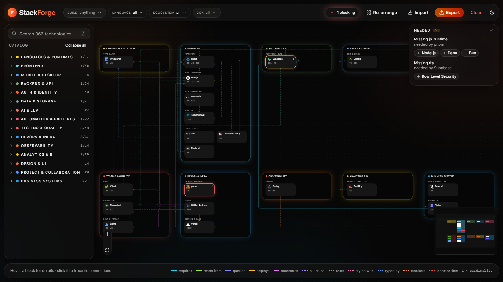
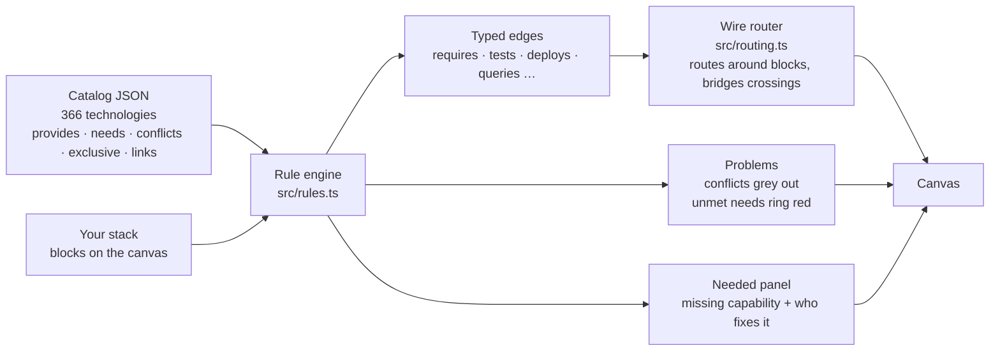
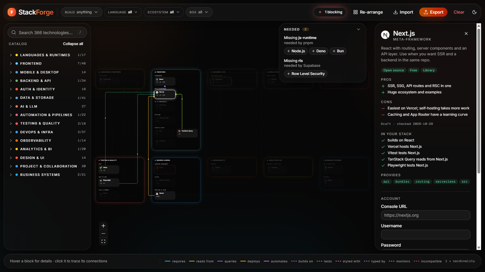
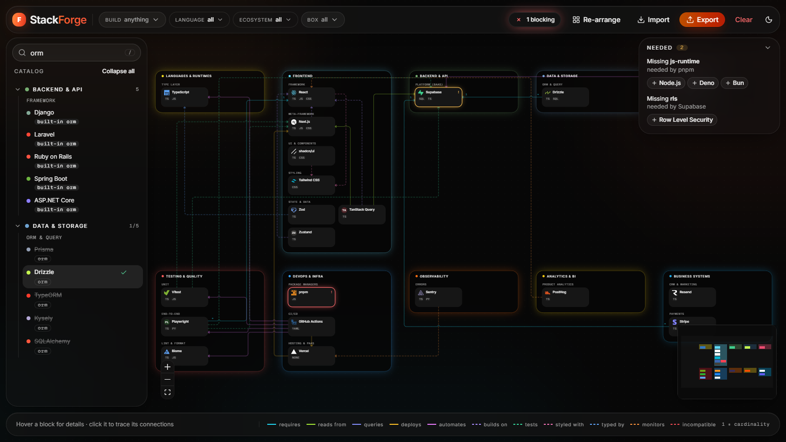
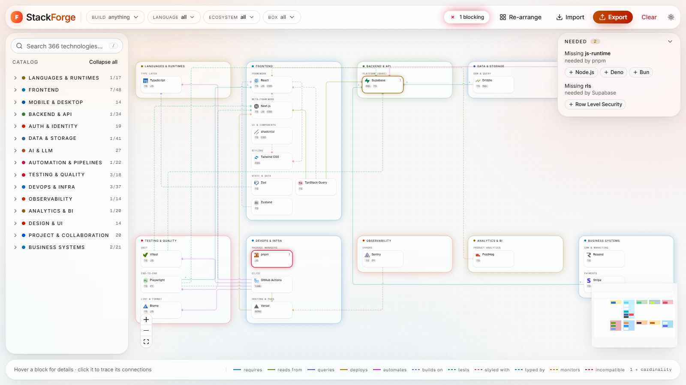

<h1 align="center">
  $${\color{#e6e6e6}\Huge \text{Stack}\color{#ffb020}\text{F}\color{#ff9628}\text{o}\color{#ff7a2f}\text{r}\color{#ff6433}\text{g}\color{#ff4d36}\text{e}}$$
</h1>

<p align="center">
  <strong>Visual technology-stack builder.</strong><br />
  Drop technologies onto a canvas and it tells you what conflicts, what is missing,
  and what connects to what.
</p>

<p align="center">
  <a href="https://github.com/engelbertgm/StackForge/actions/workflows/ci.yml">
    
  </a>
  <a href="#project-status">
    
  </a>
  <a href="#stack">
    
  </a>
</p>
<p align="center">
  <a href="#the-catalog">
    
  </a>
  <a href="#technology-profiles">
    
  </a>
  <a href="#privacy">
    
  </a>
  <a href="#license">
    
  </a>
</p>

<p align="center">
  
</p>

---

Every stack decision is really a question about a *relationship*. Does this ORM speak to
that database? If I take Firebase, what have I just ruled out? I have a queue and a
scheduler — do I actually still need a cron service? Those answers normally live in
twelve browser tabs, a whiteboard photo, and somebody's memory.

Architecture diagrams don't help, because a diagram is a drawing: it will happily let you
wire Prisma to Firestore, and it will never tell you that you have users but no way to log
them in. It knows where the boxes are, not what they mean.

StackForge is the other way round. Every technology is a data record with declared
capabilities, needs, conflicts and exclusive slots, so the picture is *derived* from the
rules rather than drawn by hand. Put two incompatible things on the canvas and one greys
out. Add an API with no database and it rings red until you fix it. The diagram cannot
show you a stack that could not exist.

## How it works



Nothing in the picture is drawn by hand. Change the catalog and the canvas, the arrows, the
warnings and the search all follow.

> [!NOTE]
> The rules are about *compatibility*, not *quality*. StackForge tells you that Prisma
> cannot talk to Firestore. It does not tell you whether you should use Prisma.
> The [technology profiles](#technology-profiles) add licence, pricing and trade-offs for that second question.

## Screenshots

<table>
  <tr>
    <td width="50%"></td>
    <td width="50%"></td>
  </tr>
  <tr>
    <td><strong>Trace and profile.</strong> Click a block: its wires stay lit, everything else fades, and the drawer shows its profile and every line it draws in your stack.</td>
    <td><strong>Explained search.</strong> Every hit says <em>why</em> it matched. Django is a <code>built-in orm</code>, Drizzle <em>is</em> an <code>orm</code>, and ORMs blocked by the stack are struck through.</td>
  </tr>
  <tr>
    <td colspan="2"></td>
  </tr>
  <tr>
    <td colspan="2"><strong>Light theme.</strong> Both themes come from one token set. A test checks every text and surface pair for WCAG contrast.</td>
  </tr>
</table>

## Features

**Compatibility, checked as you build**
- Hard conflicts grey the block out and say why — declare it once, it applies both ways
- Exclusive slots: two bundlers, two BaaS providers or two unit-test runners can't coexist
- Unmet needs ring a block red until something in the stack provides that capability
- Stack-wide rules catch gaps no single block can see: users with no auth, containers with no CI
- **Needed** panel names each missing capability, who wants it, and one-click fixes

**A diagram that reads like one**
- Wires are planned against every block and every other wire at once — they route *around*
  unrelated blocks, keep a lane apart where they run together, and arc over one another where they cross
- Arrow direction is one promise everywhere: from the thing that depends on, reads from or acts on,
  to the thing it depends on. Mutual links are arrowed at both ends
- Solid lines are runtime dependencies, dashed lines referential; `1` / `∗` marks give cardinality
- Boxes appear and disappear with their contents; the layout re-columns itself to the window

**Arranging it by hand**
- Dragging shows a ghost of where the block will land — the wires hold still until you drop
- Alignment guides snap edges and centres to their neighbours. Hold <kbd>Alt</kbd> to drop exactly where the cursor is
- **Re-arrange** puts everything back to the automatic layout

**Finding things among 366 entries**
- Search with <kbd>/</kbd>. Every result carries a pill that explains the match: `orm`, `built-in orm`,
  `#tag`, `in State & Data`. Name and capability matches rank above passing mentions in a description
- Filter by **Build** — pick "SaaS product" and every block that plays a part lights up
  wearing the part it plays: n8n as `Glue`, Stripe as `Billing`, Vitest as `Tests`
- Filter by language, ecosystem or box; each box shows how much of it the filter covers

**Deciding, not just wiring**
- Open any technology — on the canvas or straight from the catalog — to see its licence, pricing,
  hosting model, pros and cons
- **In your stack** lists every line it draws, or *would* draw once added: "Vitest tests Next.js",
  "incompatible with Firebase"
- A technology you cannot add says what blocks it before you try

**Yours, on your machine**
- Per-technology console URL, username, password and notes, in the drawer
- Export and import the whole stack as JSON
- Undo on delete, with credentials and position restored intact
- Light and dark themes, glass panels over an aurora backdrop

## Project status

**v0.3.0 — working, in active development.** Everything listed under [Features](#features) ships today.

| Area | Status |
|---|---|
| Rule engine, conflicts, exclusive slots, stack rules | ✅ Done, covered by `pnpm check` |
| Orthogonal wire router, ghost drag, snapping | ✅ Done, covered by `pnpm check` |
| Build, language, ecosystem and box filters | ✅ Done |
| Explained search | ✅ Done, covered by `search.test.ts` |
| Glass and aurora redesign on design tokens, light and dark | ✅ Done, contrast checked by `contrast.test.ts` |
| Technology profiles (licence, pricing, hosting, pros, cons) | 🟡 48 of 366 — Frontend done, 14 boxes to go |
| Process checklist ([mep](https://github.com/engelbertgm/Mise-en-place)) | 🟡 Sub-phase `foundation.setup` active — see [BRIEF.md](BRIEF.md). Its CI workflow fails until the 🔴 items close |
| Hosting | ⚪ Not deployed. Runs locally with `pnpm dev`; `vercel.json` is prepared for a future Vercel deploy |

**Next up:** profiles for the remaining boxes, then closing `foundation.setup` in the brief.

## Getting started

Requires Node 20+ and [pnpm](https://pnpm.io).

```bash
git clone https://github.com/engelbertgm/StackForge.git
cd StackForge
pnpm install
pnpm dev            # http://localhost:5173
```

Nothing to configure — there are no environment variables and no services to stand up.

> [!TIP]
> Want something to try it on? `examples/stress-test.json` is a deliberately overloaded
> 94-technology stack (231 connections, every box populated). Load it with **Import**.

## Development

| Script | What it does |
|---|---|
| `pnpm dev` | Dev server with hot reload |
| `pnpm build` | Type-check (`tsc -b`) and build to `dist/` |
| `pnpm preview` | Serve the production build |
| `pnpm check` | Rule engine, catalog, router, snapping, search, contrast and utility tests (`node --test`) |
| `pnpm test:responsive` | Playwright: no horizontal scroll, overlapping panels or console errors at each test width. Needs `@playwright/test`, which is not in `package.json` yet |
| `pnpm lint` | Biome: lint (complexity ≤ 10) and formatting check |
| `pnpm format` | Biome: rewrite formatting |
| `pnpm typecheck` | `tsc -b`, strict |
| `pnpm knip` / `pnpm dup` | Unused exports, files and dependencies / duplicated code (≤ 3%) |

`pnpm install` also installs the git hooks (lefthook): gitleaks scans staged changes for
secrets, Biome checks staged files, and commitlint enforces
[Conventional Commits](https://www.conventionalcommits.org). The secret scan needs the
[gitleaks](https://github.com/gitleaks/gitleaks) binary once: `winget install gitleaks` or
`brew install gitleaks`.

CI runs `check`, `lint`, `typecheck`, `knip`, `dup` and `build` on every push, alongside
CodeQL and the mep checklist workflow. `ci` and CodeQL pass; mep fails until its 🔴 items close.

## Privacy

Everything runs in your browser. There is no backend, no account, no telemetry, and the
only network request is brand icons from `cdn.simpleicons.org`.

Saved passwords are encrypted with **AES-GCM (PBKDF2, 310k iterations)** before they reach
`localStorage`. The passphrase is held in memory for the session and never written
anywhere, so a stolen `localStorage` dump is ciphertext.

> [!WARNING]
> Lose the passphrase and the saved password is unrecoverable — including by you.

## The catalog

Everything is driven by **data, not code**. Each technology is one JSON object in
`src/catalog/<group>.json`:

```json
{
  "id": "supabase",
  "name": "Supabase",
  "group": "backend",
  "section": "Platform (BaaS)",
  "icon": "supabase",
  "color": "#3fcf8e",
  "langs": ["sql", "ts"],
  "desc": "Postgres with auth, storage, realtime and an auto-generated API the browser calls directly. Use when you want a BaaS but refuse to give up SQL.",
  "provides": ["db", "db-sql", "auth", "storage", "realtime", "api", "data-api", "vector"],
  "exclusive": ["baas"],
  "links": [{ "to": "postgresql", "rel": "extends" }]
}
```

An add-on that only works with one product names that product's id instead of a capability,
so Supabase Edge Functions declare `"needs": ["supabase"]` and no other database satisfies it.

From those fields alone, `src/rules.ts` derives every behaviour:

| Field | What it produces |
|---|---|
| `conflicts` | Hard incompatibility. Firebase lists `postgresql`, so selecting one greys out the other with *"Firebase is not compatible with PostgreSQL"*. Symmetric — declare it once. |
| `exclusive` | Slot contention. Firebase and Supabase both claim `baas`; Vitest and Jest both claim `test-unit`. Pick one. |
| `needs` | Red ring + tooltip when nothing in the stack `provides` that capability (or is that tech, for an id), and an arrow to the provider when something does. |
| `links` | Typed arrows, drawn only when both ends are on the canvas. Vitest → Vite is `tests`; Next.js → React is `extends`. `to` may name a capability instead of a tech id: GitHub Actions → `lint` draws to whichever linter is picked. Optional `card` sets cardinality (`n-1`, `1-n`, `n-n`). |
| `provides` | Feeds the stack-wide rules in `catalog/rules.json`, and search. The first capability, or an `exclusive` slot, is what the tech *is*; the rest it ships *with* (`built-in orm`). |
| `langs` / `tags` | The language badge and filter; extra search terms. |

Two more catalog files shape the rest:

- **`groups.json`** — the 15 boxes, their colour, their left-to-right dataflow order, and the sections inside each
- **`builds.json`** — what you might be building. Each build lists *roles* (`Glue`, `Billing`, `Data`…) and the `group:Section` slots that fill them, which is what the Build filter lights up

To add a technology, copy a neighbour in the relevant JSON. To add a whole box, add it to
`groups.json` with its `sections`, create `<id>.json`, and add two lines to
`src/catalog/index.ts`. `entries.md` is the plain-text plan: what is in, what is queued.

### Technology profiles

The facts behind the drawer live apart from the rules, one file per box in
`src/catalog/profiles/<group>.json`, dated because pricing moves:

```json
{
  "checked": "2026-10-29",
  "profiles": {
    "vite": {
      "license": "oss", "pricing": "free", "hosting": "library",
      "pros": ["Near-instant dev server and HMR", "Sensible defaults, little config"],
      "cons": ["Dev and prod use different pipelines, rare mismatches"]
    }
  }
}
```

| Field | Values |
|---|---|
| `license` | `oss` · `source-available` (BSL, SSPL, ELv2…) · `proprietary` |
| `pricing` | `free` · `freemium` · `paid` |
| `hosting` | `library` · `self-host` · `cloud` · `cloud-or-self` |

A technology without a profile still works everywhere; its drawer notes that the profile is not drafted yet.

`pnpm check` fails loudly on a misspelled section name, a link pointing at a nonexistent
id, a `needs` capability nothing provides, a build glob aimed at a missing section, or a
profile with an unknown value, an undated file, or no pros or cons.

## Stack

| | |
|---|---|
|  | UI |
|  | Types, and the test runner via `--experimental-strip-types` |
|  | Dev server and build |
|  | Styling on design tokens, via `@tailwindcss/vite` |
|  | Accessible primitives: popovers, selects, alert dialogs, tooltips, scroll areas. Variants via `class-variance-authority` |
|  | Panel, drawer and theme-toggle transitions, plus `tw-animate-css` for the Radix enter and exit states |
|  | State and `localStorage` persistence |
|  | Canvas, panning, minimap |
|  | UI icons |
|  | Brand logos on the blocks, loaded from `cdn.simpleicons.org` |
|  | Self-hosted variable fonts via Fontsource |

Class names merge through [`cn`](https://www.npmjs.com/package/cn), a compiled drop-in for
clsx + tailwind-merge, extended in `src/lib/utils.ts` with the design scale's text sizes.

**Tooling**

| | |
|---|---|
|  | Package manager |
|  | Unit tests with `node:test` and `assert`, no framework |
|  | Linting and formatting |
|  | Dead code and duplication gates |
|  | Git hooks: gitleaks, Biome, commitlint |
|  | CI and CodeQL |

## Structure

```
src/
  types.ts            the schema every JSON file follows
  rules.ts            conflicts, missing pieces, arrows       (+ rules.test.ts)
  routing.ts          orthogonal wire router: side choice,
                      sockets, lane separation, bridges       (+ routing.test.ts)
  snap.ts             alignment guides while dragging        (+ snap.test.ts)
  search.ts           tiered search with match reasons       (+ search.test.ts)
  layout.ts           auto-arranges boxes and blocks
  store.ts            zustand + localStorage, filter predicate
  crypto.ts           AES-GCM for the password field
  index.css           design tokens, light and dark
  design/             WCAG contrast check on the tokens      (+ contrast.test.ts)
  catalog/            groups, rules, builds, 15 technology files
    profiles/         licence, pricing, pros and cons per box (+ catalog.test.ts)
  components/
    nodes.tsx         block, group box, typed edge
    palette.tsx       catalog sidebar and search
    drawer.tsx        detail drawer and credentials
    tech-profile.tsx  licence badges, pros and cons
    top-bar.tsx       filters, status, import/export, theme
    needs-panel.tsx   missing capabilities and their fixes
    ui/               shadcn/ui primitives
docs/
  decisions/          architecture decision records
examples/
  stress-test.json    94 technologies, 231 connections
tests/
  responsive.spec.ts  Playwright layout checks
```

`CODEMAP.md` and `REGISTRY.md` index every module and export, with what each one is for.

## Limitations

- **Profiles are drafts.** They come from public docs, carry the date they were checked, and
  only cover the Frontend box so far. Pricing tiers change; verify before you commit.
- **Compatibility is declared, not discovered.** A missing conflict in the JSON is a missing
  warning on the canvas. Pull requests fixing one are the most useful kind.

## Contributing

Adding a technology or a profile is a pull request against one JSON file. Run `pnpm check`
first — it catches almost every mistake you can make in the catalog. For behaviour changes,
keep the test alongside the module it covers. See [CONTRIBUTING.md](CONTRIBUTING.md) and
[SECURITY.md](SECURITY.md).

## Credits

Built by <a href="https://github.com/engelbertgm">engelbertgm</a>, co-authored with
<a href="https://claude.com/claude-code">Claude Code</a> — which paired on the rule engine,
the orthogonal wire router in `src/routing.ts`, the catalog schema, and the explained search.

## License

MIT — do what you want with it. See `LICENSE` for the exact text. — <a href="https://github.com/engelbertgm">engelbertgm</a>
